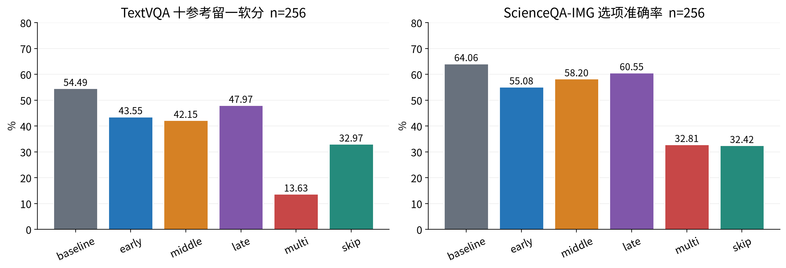

# Smolvlm-Compression-Study

SmolVLM无需训练压缩：可复现代码、可视化报告与证据。

Sean-xzx（GitHub账号）。在SmolVLM-256M-Instruct上比较视觉Encoder Top-K和LLM FFN Skip，固定两集各256题，六配置12组3072正式预测。无需训练，不扫描层/比例。

|配置|TextVQA软分 %|ScienceQA准确率 %|
|---|---:|---:|
|baseline|54.4922|64.0625|
|early|43.5547|55.0781|
|middle|42.1484|58.2031|
|late|47.9688|60.5469|
|multi|13.6328|32.8125|
|skip|32.9688|32.4219|



Encoder剪枝真实减少内部矩阵量和部分本机小样本wall，但全部质量下降，Multi/Skip损失尤其大。postnorm后零回填保持原Connector及LLM视觉位置，原参数256484928和权重513028808 bytes不变；没有明显allocated峰值节省。旧fixed16主基准Skip约0.993×/1.002×，不能把自然生成少输出当同工作量提速。Science64.0625%未复现官方73.6%完整recipe。

- 完整报告：[PDF](report/REPORT.zh.pdf)、[Markdown](report/REPORT.zh.md)、[可编辑Word](report/REPORT.zh.docx)。正文、表格和图注已完成；AI贡献见报告§17，未宣称用户已审阅或独立掌握。
- 运行入口：[接收者复现页](docs/REPRODUCTION.zh.md)。新增[evaluate_release.py](scripts/evaluate_release.py)复用冻结科学helper，实际24条新预测与partial聚合通过；完整256新入口未实跑。
- 原文覆盖：[67项映射](docs/REQUIREMENTS_MAPPING.zh.md)、[教授原文](docs/ASSIGNMENT.zh.md)、[证据导航E1–E8](docs/EVIDENCE_INDEX.zh.md)。实现证明、质量、成本、性能和个人能力分开记录。
- 图表：[SVG/PNG/数据/manifest](figures)、[绘图脚本](scripts/build_figures.py)。主图使用旧780性能版本，不与v3 120混用。
- 技术交流：[约30分钟slides与讲稿](talk)、代码定位、三项练习/参考解法和离线速查由同目录统一提供。材料不证明用户已完成独立演练。
- 来源许可：[NOTICE](NOTICE.md)、[上游与改动](docs/SOURCES_AND_CHANGES.zh.md)、[保留许可](licenses)。未给混合工程统一新许可证。

## 完整科学证据包

轻量Git用于阅读源码、报告和新增薄入口，运行时仍需完整postday3-v3包作为artifact-root。原包名Shen-Wu-Challenge-postday3-v3.tar.gz，455733348 bytes，SHA256：

```text
d95a7774653f0b35f5e7cb37619807c27b0d295e0494d29b90b4be22bcec0d4d
```

[公开仓库](https://github.com/Sean-xzx/Smolvlm-Compression-Study) · [Release附件](https://github.com/Sean-xzx/Smolvlm-Compression-Study/releases)。使用Release中的原科学包，按复现页校验并解包，传入--artifact-root；artifacts、模型/缓存、环境不进Git。公开下载验收及实际版本以main分支的[发布记录](docs/PUBLICATION.zh.md)为准；历史验收文件保留原检查时点。

## 验证边界

旧3072质量、旧780正式/312预热、v3迁移120正式/48预热与本轮24新预测分别登记。已测同机Linux、BF16/eager/batch1及共享解释器/HF热缓存；未测冷安装、跨机、Flash/SDPA、新入口全256和v3 first/stages。Text聚合独立而normalizer同源，Science采用官方索引准确率定义加本地文本解析；失败保留分母。详见报告及[24条验收](verification/NEW24_ACCEPTANCE.json)。

## 公开交付验收

[正式Release](https://github.com/Sean-xzx/Smolvlm-Compression-Study/releases/tag/autonomous-20261031-release) · [报告PDF下载](https://github.com/Sean-xzx/Smolvlm-Compression-Study/releases/download/autonomous-20261031-release/REPORT.zh.pdf) · [最终交接](docs/FINAL_HANDOFF.zh.md)。匿名源码ZIP 148/148文件与发布快照相同，14个初始附件已完整匿名下载核SHA；详见[发布验收](docs/PUBLICATION.zh.md)。
