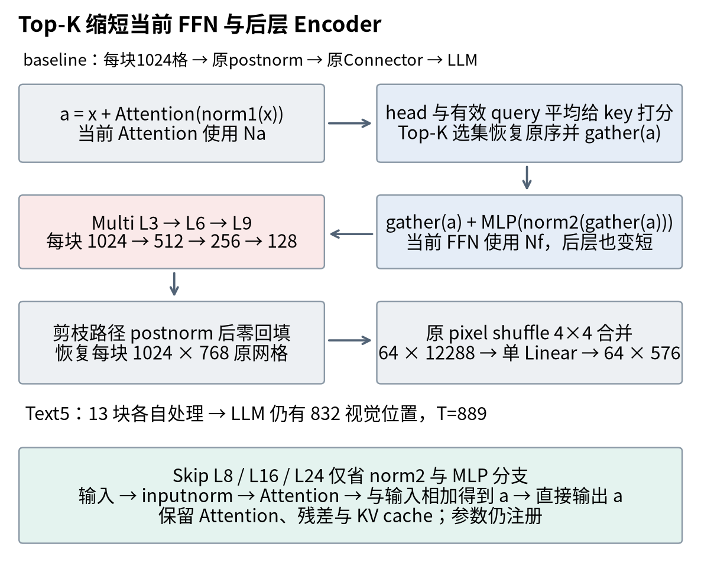
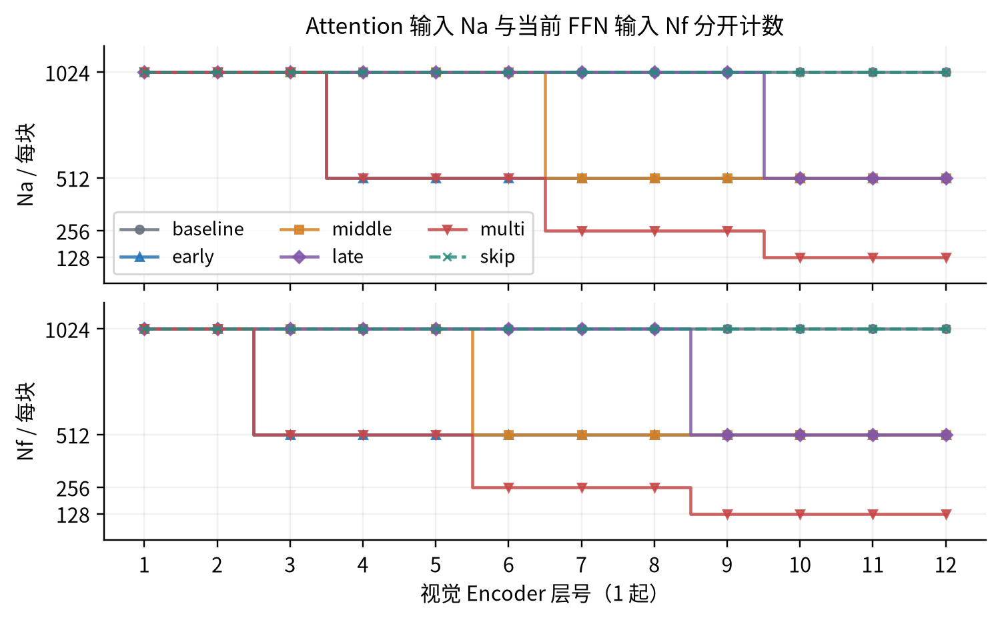
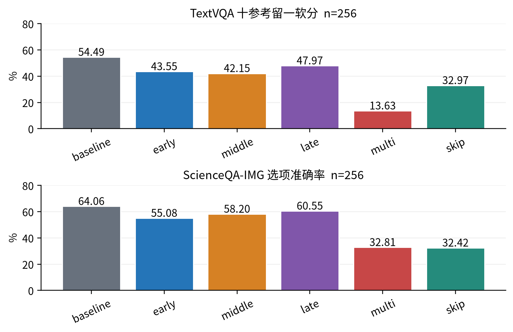
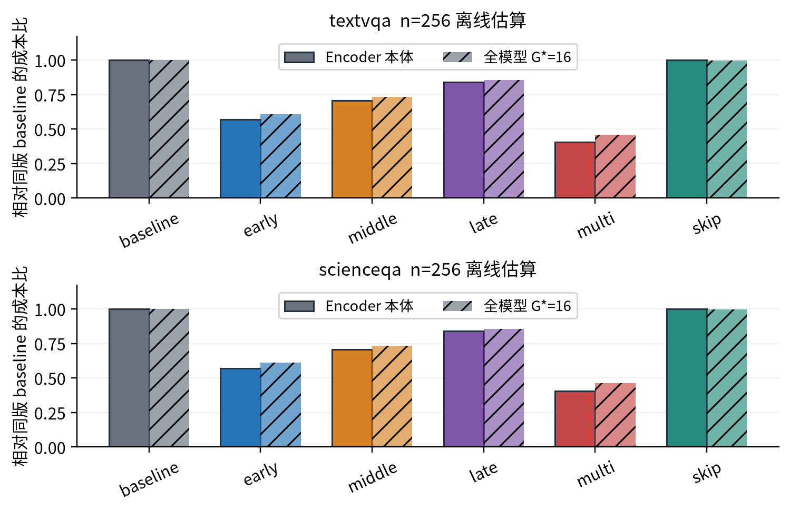
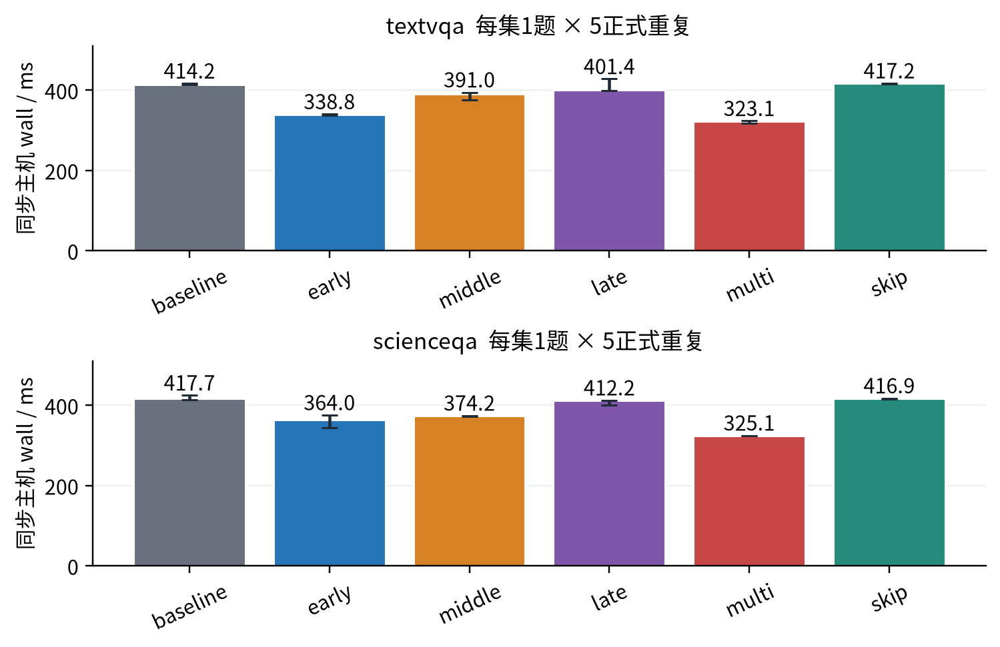
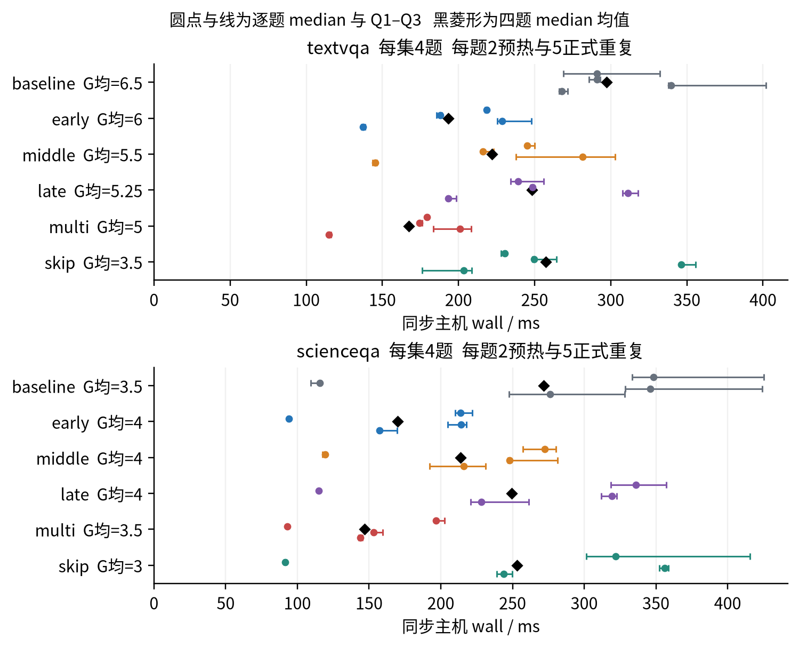

# SmolVLM无需训练压缩实验报告

Sean-xzx（GitHub账号） · 2026年10月31日

报告版 professor-report-v2 · 科学底稿 context-v2 / cost-perf-v1 / postday3-v3

## 0 概要与阅读路线

在SmolVLM-256M-Instruct原始权重上，比较四种视觉Encoder Top-K与三层LLM FFN Skip。六配置在TextVQA、ScienceQA-IMG各固定256题上完成12组、3072条正式预测。任务A保持LLM不变，任务C保持Encoder不变；任务B只解释连接方法，没有新增连接器实验。

主要发现是计算量减少伴随质量损失。Late的两集分数为47.9688%/60.5469%，相对基线下降6.5234/3.5156 pp，已是四种Encoder剪枝中损失最小的一组。Multi的Encoder主要FLOPs减少59.588%，但质量降至13.6328%/32.8125%。Skip固定16输出token的速度比仅0.993×/1.002×，没有明确同长度收益。

Encoder内部缩短不等于端到端视觉序列缩短：剪枝特征经postnorm后零回填再走原Connector，LLM视觉位置保持。六配置总参数256,484,928、原权重513,028,808 bytes均不变，约2902 MiB的allocated峰值也未明显下降。

阅读顺序为实验协议→任务A四问→任务B→任务C三问→统一结果→执行证明。附录A给完整逐层Token，B给公式及成本分项，C给矩阵形状与耗时，D给统计/版本，E给原文覆盖索引。性能结论限于同机小样本，新增24条薄入口验证不进入正式质量表。

[任务A](#2-任务a-encoder-top-k) · [任务B](#3-任务b-projector) · [任务C](#4-任务c-ffn-skip) · [结果](#5-统一结果与取舍) · [证明](#6-正确性与真实执行) · [附录](#附录a-完整逐层token)

## 1 实验设计与评分

### 1.1 固定输入与公平比较

模型为HuggingFaceTB/SmolVLM-256M-Instruct。版本如下；均为default配置，数据使用validation。

|对象|固定revision|
|---|---|
|模型|7e3e67edbbed1bf9888184d9df282b700a323964|
|lmms-lab-encoder/textvqa|9c0699cd19768ac5ab97568f6b3cbac4c0062884|
|lmms-lab/ScienceQA-IMG|b9984af01798586705cee1fbdfa80a6dcbef04f1|

每集独立用Random(20261029)从5000/2097题无放回抽256并升序，保存stable_id、row_index、图像SHA与meta。六配置使用相同图片、prompt和input IDs。随科学包提供512张RGB无损PNG；Idefics3Processor原生resize/rescale/normalize与图像splitting，最长边2048、图块512，每块1024视觉位置，无额外CLS。

Text输入图片、问题和短答案指令，不添加OCR字段。Science输入图片、非空原始hint、问题、原序选项及字母答案指令；answer仅在输出后评分，lecture/solution不作输入。hint协议在控制诊断前冻结，旧无hint基线58.984375%不参与本报告分差。

正式环境为Python3.10.12、torch2.7.1+cu128、Transformers4.57.6、RTX5090 Laptop 24463 MiB、driver580.178.04。统一BF16、eager、batch1、eval/inference_mode、seed0、确定性、TF32关闭；pixel_values输入实际为FP32，由原生模型按需转dtype。greedy、beam1、max_new_tokens64及原EOS/cache一致。eager显式取得Attention权重，基线也用eager；Flash/SDPA未测。

### 1.2 两个指标及失败规则

Text采用原样MMF EvalAIAnswerProcessor和TextVQAAccuracyEvaluator：每题十参考，依次留出一个参考，用其余九个的匹配数m计算min(m/3,1)，对十次留一再平均。十条中标准化后有c次匹配时：

```text
s(c) = [(10−c) min(c/3,1) + c min(max(c−1,0)/3,1)] / 10
c = 0, 1, 2, 3, 4, 10  →  s = 0, 0.3, 0.6, 0.9, 1, 1
```

该指标是软分，不能当作整数答对率。1536条Text历史输出独立闭式重聚合差异为0；normalizer仍与MMF/Pythia同源，未构成完整异源评分器验证。

Science使用官方选项索引准确率定义，生成文本用本地extract_choice v2保守、label-blind地解析。官方指标与本地文本解析分开说明：没有原样运行官方完整管线。空输出/解析失败记0并保留256分母；执行异常保留错误并标未完成。正式3072条无执行异常。Science基线64.0625%不等于完整复现模型卡73.6%的历史recipe。协议、清单及评分证据见[E1/E5](../docs/EVIDENCE_INDEX.zh.md#e1)。

## 2 任务A Encoder Top K

### 2.1 算法与四配置

记a=x+Attention(norm1(x))。在Attention残差后、当前FFN前，取原生权重[块,head,query,key]，以FP32先平均head，再在有效query上平均，得到每个key的incoming attention分数；无效key置负无穷。

每块K=max(1,ceil(rate×当前有效数))。稳定降序选最高K，平分以原网格位置为序；选集再按原位置升序，真实gather(a)进入norm2与MLP。输出为gather(a)+MLP(norm2(gather(a)))。当层Attention仍用旧长度Na，当层FFN先用短长度Nf，后层Attention才变短。支持升序1起层列表和逐阶段比例，拒绝越界/重复层；实现见[prune_layer](../scripts/encoder_topk.py#L153)。

|配置|Encoder层号|阶段保留率|实际K及最终率|Skip层|
|---|---|---|---|---|
|baseline|无|无|1024；100%|无|
|early|3|50%|512；50%|无|
|middle|6|50%|512；50%|无|
|late|9|50%|512；50%|无|
|multi|3→6→9|各50%|512→256→128；12.5%|无|
|skip|无|无|1024；100%|8/16/24|

Encoder共12层，L/4、L/2、3L/4恰为3/6/9。三个单点分别独立运行；Multi同一次前向在每个阶段当前序列重新打分。没有训练、层/比例扫描或两方法叠加。

图块各自作为batch项，TextVQA row5的13块不能当一条13312长序列。不同有效K以Kmax物理占位，padding不参与评分/回填；正式24576层记录padding均0。受控有效数[16,5]按ceil依次得[8,3]→[4,2]→[2,1]，只验证边界处理。Multi逐层复合原位置，保留特征已混合前层信息，不能由位置删除推断信息完全消失。



图1 少算发生在Encoder内部及Skip分支，LLM视觉位置不变。来源：encoder_topk.py、ffn_skip.py与context-v2 B4 Text row5形状；n=1代表题，单位为token/块与特征维度，流程示意无统计误差或归因含义。

### 2.2 必答A1 参数存储与逐层Token

六配置实际注册参数sum(p.numel())均256,484,928，原模型权重文件stat均513,028,808 bytes；未导出更小checkpoint。Top-K改变激活序列，不删参数。每块Encoder稀疏出口由1024变为单点512或Multi128，分别减少50%/87.5%，但前面已执行的层并未同比减少。图2区分Na与Nf，完整12层数值见附录A。



图2 剪枝当层FFN先变短，Attention到下一层才缩短。来源：context-v2 B4/B6 Text row5直接记录；n=1代表题、13独立块，单位token/块；baseline与Skip重合，无跨题均值或误差带。

### 2.3 必答A2 Encoder与全模型FLOPs

乘加计2，仅汇总主要矩阵/卷积。单视觉层为8BNa dv²+4BNa²dv+4BNf dv mv，分别包含QKV/O、QK/AV和两个FFN矩阵。按附录A逐层求和，不能用最终保留率乘整模型。dv=768、mv=3072。

统一离线G*=16时，Early/Middle/Late的Encoder本体减少43.182%/29.545%/15.909%，Multi减少59.588%；全模型两集成本比例分别为0.6077/0.6104、0.7316/0.7334、0.8555/0.8564、0.4586/0.4623。具体GFLOPs见§5.2，完整prefill/decode推导、实际G分项及选择开销见附录B。G*=16是离线估算，不是512题额外fixed16实测。

FP32打分算术按BN²(H+2)，转换按每Attention元素读2写4 bytes；每阶段每块3次稳定argsort。比较排序、gather/scatter、CPU循环和同步、KV移动等不纳入主要FLOPs，仍保留在生产计时中。少矩阵量不保证等比例wall收益。

### 2.4 必答A3 被丢弃Token未进入FFN和后层的证明

Text row5固定B=13、T=889的pre-hook直接观测：Early L3/L4的fc1输入均[13,512,768]，Middle L6/L7与Late L9/L10亦为该形状。Multi L3/L4、L6/L7、L9/L10依次为K=512/256/128。fc1实际addmm从[13312,768]×[768,3072]缩为[13K,768]×[768,3072]，fc2同样缩短。对应CPU/CUDA微秒在附录C逐项列出；后层Attention的q_proj及QK/AV矩阵也在那里给出，覆盖每次剪枝后计算。

这些是实际输入与算子记录，100%旁路一致性不能替代。详细[E3](../docs/EVIDENCE_INDEX.zh.md#e3)提供JSON/trace；诊断profiler单次耗时用于路径核验，不作为规范速度统计。

### 2.5 必答A4 从视觉输入到LLM的传递

稀疏Encoder出口经原post_layernorm，再将保留特征按原位置scatter到零网格；零回填只在剪枝适配路径，且在postnorm之后，避免norm bias改变占位零。原Connector的pixel shuffle和Linear不变。Text row5的实际路径如下。

|位置|baseline / skip|单点Top-K|Multi|
|---|---|---|---|
|Encoder输入|13×1024×768|13×1024×768|13×1024×768|
|Encoder稀疏出口|13×1024×768|13×512×768|13×128×768|
|原Connector入口|13×1024×768|回填13×1024×768|回填13×1024×768|
|pixel shuffle后|13×64×12288|13×64×12288|13×64×12288|
|Linear输出|13×64×576|13×64×576|13×64×576|
|LLM视觉位置 / 总T|832 / 889|832 / 889|832 / 889|

单位为张量shape或token。剪枝没有减少本样本的LLM视觉位置、Connector计算和同G下LLM长度；832是该代表题数量，各题块数不同（附录D）。保留位置回填精确相等、丢弃位置精确0，见§6。

## 3 任务B Projector

本节仅作文字说明，不增加四种连接器实验。特征宽度映射与token数量变化是不同设计维度。

|方法|如何映射特征|对token数量的作用|
|---|---|---|
|Linear|逐位置乘权重矩阵|pointwise形式保持N|
|MLP|逐位置多层Linear与非线性|pointwise形式通常保持N|
|Q-Former|学习query通过跨注意力读取视觉特征|输出由设计的query数决定|
|Perceiver Resampler|固定学习latent作query重采样；Flamingo将视觉与latent特征拼入K/V|输出为latent数，典型64，与输入网格长度解耦|

指定模型沿用HF Idefics3 Connector：先4×4 pixel shuffle空间合并，使每块1024位置变为64、通道768变为12288，再以无bias Linear投影到576。SimpleMLP类名在此并不表示多层网络，实际只有一个Linear。数量下降来自空间合并，特征宽度下降来自Linear。

剪枝后如何接入见§2.5的零网格适配；这保留了原位置/尺寸契约，也使LLM序列未继续缩短。代码见[connect与restore_grid](../scripts/encoder_topk.py#L180)，原生HF代码及许可见[来源清单](../docs/SOURCES_AND_CHANGES.zh.md)。概念来源为[BLIP-2 Q-Former](https://arxiv.org/abs/2301.12597v3)、[Flamingo §2.1及附录A.1.1](https://arxiv.org/abs/2204.14198v2)与[LLaVA projector builder](https://github.com/haotian-liu/LLaVA/blob/c121f0432da27facab705978f83c4ada465e46fd/llava/model/multimodal_projector/builder.py)。

## 4 任务C FFN Skip

### 4.1 三层选择与残差归一化

30层LLM中预先分散选8、16、24层同时Skip，未搜索最优层。SkipPatch支持1起层列表并检查范围/重复。每个目标层保留input_layernorm、Attention、KV cache及残差，输出a=x+Attention(inputnorm(x))，省去整个post_attention_layernorm与MLP分支；最终norm保留。不是将MLP改为Identity，也没有先算再乘零。实现见[skip_forward](../scripts/ffn_skip.py#L16)。

### 4.2 必答C1 存储参数与停用FFN参数

按sum(p.numel())统计，六配置总参数与权重文件大小仍为§2.2数值。每层gated FFN的gate/up/down三个无bias矩阵共有3×576×1536=2,654,208参数，三层共7,962,624；另外省去三份norm2计算，对应1,728个权重。它们仍在state_dict中，因此停用计算不等于实际存储减少。

### 4.3 必答C2 prefill与decode成本

输入长度T包括视觉位置和文本。生成G个新token时，首输出归prefill，其后G−1次cached decode。三层FFN节省为：

```text
ΔFprefill = 3 × 6 × 576 × 1536 × T
ΔFdecode = 3 × 6 × 576 × 1536 × (G−1)
ΔFtotal = 15,925,248 × (T+G−1)
```

G=1时decode为0；Attention仍30层、FFN变为27层。该主要矩阵公式不含norm2等辅助运算。视觉与Connector只在prefill执行一次。G*=16离线统一成本下，Skip全模型仅减少约0.47%/0.49%；实际G的各分项和范围见附录B/D，规范同长度实测见§5.3。

### 4.4 必答C3 调用与profiler证明

旧cost-perf-v1固定Text row1848、B=13、T=888，分别记录一次prefill及独立cache一步decode。每个目标层、每个阶段的实测计数如下。

|目标层|配置|inputnorm / Attention|norm2 / MLP|投影marker合计|
|---|---|---|---|---|
|8|baseline|1 / 1|1 / 1|各2次合计|
|8|skip|1 / 1|0 / 0|均缺席|
|16|baseline|1 / 1|1 / 1|各2次合计|
|16|skip|1 / 1|0 / 0|均缺席|
|24|baseline|1 / 1|1 / 1|各2次合计|
|24|skip|1 / 1|0 / 0|均缺席|

表中norm/MLP/Attention为每阶段调用数，gate/up/down marker为两阶段合计；原记录缺少的目标项按0计。非目标层正常，final norm每阶段1次。v3另一个Text row5短trace中，两阶段MLP投影矩阵数180→162，恰减少3层×3投影×2阶段=18；不将其毫秒混入主性能。零调用结合投影区间缺席，支持目标FFN确实未计算，未声明所有生成步都有trace。原件见[E4](../docs/EVIDENCE_INDEX.zh.md#e4)。

## 5 统一结果与取舍

### 5.1 全部配置质量下降



图3 所有变体均低于同版基线。来源：context-v2原3072条逐题score；每组n=256，算术均值×100，单位%，轴从0起；解析失败记0保留分母。Text为十参考留一软分，Science为选项准确率。

|配置|Text %|Δ pp|Science %|Δ pp|Sci解析失败|
|---|---|---|---|---|---|
|baseline|54.4922|+0.0000|64.0625|+0.0000|1|
|early|43.5547|-10.9375|55.0781|-8.9844|1|
|middle|42.1484|-12.3438|58.2031|-5.8594|1|
|late|47.9688|-6.5234|60.5469|-3.5156|1|
|multi|13.6328|-40.8594|32.8125|-31.2500|28|
|skip|32.9688|-21.5234|32.4219|-31.6406|41|

Late在四种Encoder变体中质量损失最小，Multi/Skip损失很大。Skip Science的41条解析失败即使全救回，上界48.4375%仍低于基线64.0625%，格式失败不能解释全部损失；该上界不排除其他未标记解析问题。未通过改解析器或删题提高报告分数。

真实失败例为Text row5：baseline输出“22.”、Multi输出“2.”，分数1→0；相同输入的LLM视觉位置均832。案例按预定类别最小原索引选择，完整raw/参考见[E5](../docs/EVIDENCE_INDEX.zh.md#e5)。没有Attention归因实验，不能断言删掉某文字patch导致错误。

### 5.2 理论计算量和实际存储分开



图4 Encoder节省不能直接当作全模型节省。来源：cost-perf-v1 costs_G16.csv，真实T/B、离线G*=16，每集n=256；各组GFLOPs均值相对同集基线之比，单位为比例，乘加计2；Encoder本体不含patch。

|配置|Encoder GF T/S|Encoder比|全模型 GF T/S|全模型比 T/S|
|---|---|---|---|---|
|baseline|2903.33 / 2986.38|1.0000|3195.75 / 3309.64|1.0000 / 1.0000|
|early|1649.62 / 1696.81|0.5682|1942.04 / 2020.07|0.6077 / 0.6104|
|middle|2045.53 / 2104.04|0.7045|2337.95 / 2427.30|0.7316 / 0.7334|
|late|2441.44 / 2511.27|0.8409|2733.86 / 2834.53|0.8555 / 0.8564|
|multi|1173.29 / 1206.85|0.4041|1465.71 / 1530.11|0.4586 / 0.4623|
|skip|2903.33 / 2986.38|1.0000|3180.68 / 3293.32|0.9953 / 0.9951|

T/S分别为TextVQA/ScienceQA-IMG，GF为单题均值十亿FLOPs。两集块数不同而Encoder相对比相同。参数/权重均未变（§2.2、§4.2），理论成本下降不是文件压缩或已证明的峰值内存下降。

### 5.3 固定长度与自然生成延迟

主性能只用cost-perf-v1：natural/first每集4道按长度选取的题，fixed16/stages每集1道诊断题，每题2预热5正式重复。780正式/312预热分为natural240、first240、fixed16 60、stages/decode240；首尾锚点另计20正式。同步包围GPU已有输入到native generate返回，perf_counter主机wall为主；不含加载、解码图片、Processor、H2D、评分、I/O及调试hook，生产选择/回填/同步保留。CUDA Event是辅助stream elapsed，不是纯kernel求和。



图5 统一G=16后Skip几乎无速度收益。来源：cost-perf-v1 fixed16原始测量，每集n=1题、2预热5正式；柱为median，误差端点为真实Q1/Q3，单位ms，不是置信区间。min=max_new_tokens16，文本不进入质量表。

两集Skip速度比0.993×/1.002×；Early为1.223×/1.147×、Multi为1.282×/1.285×，伴随§5.1的质量损失。完整首token、fixed16及自然延迟/实际G/速度比在附录D，不使用v3基线重算这些比例。



图6 自然输出长度变化使wall加速不能等同同工作量加速。来源：cost-perf-v1 natural，每集n=4题、每题2预热5正式；圆点为各题median，线为各题真实Q1/Q3，黑菱形为四题median均值，单位ms；G均为四题实际生成长度均值，无总体置信区间。

例如Text Skip平均G由6.5降至3.5，输出变短参与了自然延迟变化。allocated峰值约2902 MiB，剪枝略增、Skip几乎相同；reserved是分配器历史，不能代替活跃显存。旧锚点变化Text−2.46%、Science+3.83%，未过10%线，但未锁频、小n仍限制外推。

主要FLOPs不含排序、gather、回填、CPU同步和框架调度全部开销。旧独立Connector回放剪枝约4–5 ms、基线约0.3–0.5 ms，给出适配开销的实测落点；这些独立median不能相加为端到端，也不能用总wall减vision推出LLM耗时。部分模块median顺序不符合包含关系，未用配对实验定位时钟/调度等原因。单步decode以fresh prefill cache和固定基线首token回放，wrapper含位置/cache张量构造。

## 6 正确性与真实执行

以下均为已保存的context-v2/v3实测证明，报告改版只读提取；有限固定样本不保证任意输入。

|检查对象|对象与容差|保存结果|
|---|---|---|
|单点100%与Multi全100%|Text5/Science2×4模式；Encoder、postnorm、Connector、prefill logits；atol=rtol=0|32张量最大绝对误差0，完整生成IDs相等；score/scatter调用0|
|空Skip|两输入prefill及独立cache一步decode最后位置logits；atol=rtol=0|最大误差0，完整生成IDs相等|
|真实50%与Multi|四配置各4真实样本，受控mask/残差、24真实stage独立重建选集|FFN/后层短形状及矩阵见§2.4/附录C|
|padding与回填|有效[16,5]；postnorm后原位置对齐|禁用key权重109584项最大0；扰动padding不改有效输出；保留相等、丢弃精确0|
|恢复与清理|全named_modules的forward/hook、参数身份/指针/version|正常退出与五配置受控异常恢复；未测任意OOM/kill|

100%关闭额外路径走原生bypass，只证明无压缩一致性，不检验真实50%排序/gather；后者由独立受控数值、pre-hook与矩阵支撑。Encoder未单独比较decode logits；空Skip则显式覆盖独立cache一步decode。三层非空Skip执行证据见§4.4。

Git中的B2 proof_index是导航摘录，不是完整证明。约50 MB完整proof、全部trace与3072原子结果在科学附件；精选JSON和图源通过[E2–E7](../docs/EVIDENCE_INDEX.zh.md#e2)定位。v3保存27条命令exit0、512图SHA、12条严格重放与两套3072成本字节一致；新增24条另版验证薄入口，不扩充这里的主质量/主性能样本。

## 7 结论限制来源与复现

### 7.1 可以支持的结论和未验证范围

该适配真实减少Encoder内部张量和主要矩阵量，同机小基准中部分配置wall改善，代价是全部变体质量下降。Late较少损失与较少成本节省、Multi大幅损失，是固定协议下的观察，未证明最优层或质量损失的唯一机制。零网格保留了原Connector/LLM位置契约，权重存储未缩小；Skip质量代价大，同长度速度收益不明确。早期密集Attention可能影响内存峰值，但没有独立分配时间线来证明原因。

范围只有一个GPU、BF16、batch1、eager及两固定validation子集。冷安装、冷模型/数据获取、跨机/其他GPU/Windows/macOS、新入口完整256、Flash/SDPA、v3 first/stages、严格replay limit256与任意OOM/kill未验证。未训练、扫参、追官方分数或为改报告追加实验；没有将新24调度时间当规范性能。

### 7.2 来源许可与AI实际贡献

模型、Processor、generate、Idefics3/Llama模块直接复用Transformers4.57.6；EncoderTopKPatch和SkipPatch是固定源码的实例级适配。Text评分原样复用MMF，Science指标参考官方实现、文本解析为本地适配。代码来源/固定SHA/许可在[来源与改动](../docs/SOURCES_AND_CHANGES.zh.md)、[NOTICE](../NOTICE.md)逐项保留，混合工程未统一宣称MIT/Apache。

AI主要完成代码适配、实验编排、统计与自动核验，并完成薄入口、已执行24条小样本验证、报告正文/图注/图表/排版、导航和汇报准备。此次报告改版由AI自主写作、只读复算、渲染和发布。Sean-xzx提供任务、约束、公开与范围决策；未声称其亲写原稿、人工逐题核验、已审阅或已独立掌握。技术交流准备材料不证明个人能力验收；教授指定现场环节可查代码文档，须本人独立完成、不用AI/Agent。

实际自动检查包括原子分数重聚合、源SHA与矩阵/调用记录核对、Markdown/Word同源构建及PDF逐页渲染。历史勘误/失败保留原结论，不修改原hash或绕assert。

### 7.3 接收者的最短复现路线

从[当前仓库](https://github.com/Sean-xzx/Smolvlm-Compression-Study)取得main；按[复现命令页](../docs/REPRODUCTION.zh.md)下载固定postday3-v3完整科学包、校SHA、解包，准备固定依赖与模型缓存。单独clone不含全部图片与父证据。以下变量U为解包根，P为固定依赖解释器，OUT为包外全新输出根；安装与数据准备细节见命令页。

```bash
python3 -B scripts/check_repository.py --artifact-root "$U"
"$P" -B "$U/scripts/release_checks.py" --mode data --output-dir "$OUT/data"
"$P" -B scripts/evaluate_release.py --artifact-root "$U" \
  --configuration early --limit 2 --output-dir "$OUT/new-early"
"$P" -B "$U/scripts/release_checks.py" --mode correctness --output-dir "$OUT/check"
"$P" -B "$U/scripts/release_checks.py" --mode performance \
  --configuration baseline --phase fixed16 --output-dir "$OUT/perf"
"$P" -B "$U/scripts/release_checks.py" --mode profiler --output-dir "$OUT/profile"
"$P" -B "$U/scripts/analyze_costs.py" \
  --probe-root "$U/evidence/day2_evening/cost_perf_v1" --output-dir "$OUT/cost"
```

更换configuration遍历六配置。evaluate_release复用原loader、prompt、补丁、generate、评分和汇总，输出逐题raw/IDs/score/parse/T/G与绑定；history-compare可选，仅诊断相等。已测六配置各两集前2题（Text5/19、Science2/9），共24条、无异常/解析失败，partial_mean_score与完整mean_score隔离。完整256可传参但未实跑。严格逐字重放另用U/scripts/replay_release.py，区别于新评估。

### 7.4 主要参考与报告版本

[模型固定revision](https://huggingface.co/HuggingFaceTB/SmolVLM-256M-Instruct/tree/7e3e67edbbed1bf9888184d9df282b700a323964)；[TextVQA评分说明](https://textvqa.org/challenge/)与[MMF固定评分源码](https://github.com/facebookresearch/mmf/blob/72f898ec35af86567423c7a019dd1dc5175d1a5a/mmf/utils/m4c_evaluators.py)；[ScienceQA官方准确率定义](https://github.com/lupantech/ScienceQA/blob/2cbf8318e07b9ece895bb2ae605e71e38d623264/tools/evaluate_acc.py)；[题目Token压缩参考](https://arxiv.org/abs/2504.01690v2)仅供方法参考，未运行其音频框架。Projector概念来源在§3。

本报告professor-report-v2与旧Release autonomous-20261031-release内17节报告不同；旧tag/附件及其SHA回执保留历史。当前报告以main/report为入口，Word由本Markdown生成，PDF由Word同源导出。slides保持旧版，尚未随本报告重制。实际下载/版本关系见[PUBLICATION](../docs/PUBLICATION.zh.md)。

## 附录A 完整逐层Token

每格为Na/Nf，单位token/图块；context-v2 Text row5、13独立图块。baseline与Skip视觉路径相同。单点出口512，Multi出口128；回填发生于Encoder之后，不送回后层Encoder。全两集24576条逐层原记录见E3，图源为layer_tokens.csv。

|层|baseline及skip|early|middle|late|multi|
|---|---|---|---|---|---|
|1|1024/1024|1024/1024|1024/1024|1024/1024|1024/1024|
|2|1024/1024|1024/1024|1024/1024|1024/1024|1024/1024|
|3|1024/1024|1024/512|1024/1024|1024/1024|1024/512|
|4|1024/1024|512/512|1024/1024|1024/1024|512/512|
|5|1024/1024|512/512|1024/1024|1024/1024|512/512|
|6|1024/1024|512/512|1024/512|1024/1024|512/256|
|7|1024/1024|512/512|512/512|1024/1024|256/256|
|8|1024/1024|512/512|512/512|1024/1024|256/256|
|9|1024/1024|512/512|512/512|1024/512|256/128|
|10|1024/1024|512/512|512/512|512/512|128/128|
|11|1024/1024|512/512|512/512|512/512|128/128|
|12|1024/1024|512/512|512/512|512/512|128/128|

## 附录B FLOPs推导与分项

### B1 计数范围和公式

符号：图块数B、N0=1024、视觉dv=768/mv=3072/H=12；LLM d=576/m=1536、30层、9Q/3KV、head维64、d_kv=192、词表V=49280。Na/Nf使用附录A各层实际物理长度，正式padding0。FMA计2；矩阵总数不等于硬件指令实测。

|部分|主要FLOPs与推导|
|---|---|
|patch卷积|2BN0(3×16²)dv|
|视觉QKV/O|4个dv×dv投影：8BNa dv²|
|视觉QK/AV|两次Attention矩阵乘法：4BNa²dv|
|视觉fc1/fc2|两次矩阵乘法：4BNf dv mv|
|原Connector|2B×64×12288×576|
|LLM每层GQA投影|Q/O宽d、K/V宽d_kv：4qd(d+d_kv)|
|LLM每层QK/AV|4qsd，s为含当前输入的KV长度|
|LLM每层gated FFN|3个矩阵：6qdm；基线30层、Skip27层|
|输出头每调用|2×1×d×V；只处理最后位置|
|合计|patch + Σ视觉层 + Connector + LLM prefill + Σdecode + G个输出头|

prefill令q=s=T；decode第j步（j=1…G−1）令q=1、s=T+j。n=G−1，则decode的Σs=nT+n(n+1)/2。视觉与Connector仅prefill一次；完整G输出共G次头调用。Skip减少的三层FFN如§4.3，norm2辅助运算另列。每题B/T/G不同，先按原子记录算再汇总，不能用平均T代入T²。

### B2 实际G下全256题均值

下面每格单位GFLOPs/题；视觉含patch，LLM prefill/decode均不含输出头。原costs_actual_G.csv每配置/数据集256行，实际G不强制相同。统一G*=16总量见§5.2，完整两模式均值/范围在costs.csv和ranges.csv。

TextVQA：

|配置|视觉含patch|Connector|prefill|decode|head|合计|
|---|---|---|---|---|---|---|
|baseline|2919.83|12.37|258.48|1.18|0.30|3192.16|
|early|1666.12|12.37|258.48|1.19|0.30|1938.46|
|middle|2062.02|12.37|258.48|1.14|0.29|2334.32|
|late|2457.93|12.37|258.48|1.32|0.33|2730.43|
|multi|1189.79|12.37|258.48|1.47|0.36|1462.48|
|skip|2919.83|12.37|243.65|1.28|0.34|3177.47|

ScienceQA-IMG：

|配置|视觉含patch|Connector|prefill|decode|head|合计|
|---|---|---|---|---|---|---|
|baseline|3003.35|12.73|288.42|0.98|0.26|3305.73|
|early|1713.77|12.73|288.42|0.82|0.22|2015.96|
|middle|2121.01|12.73|288.42|0.83|0.22|2423.20|
|late|2528.24|12.73|288.42|0.91|0.24|2830.54|
|multi|1223.82|12.73|288.42|0.88|0.23|1526.08|
|skip|3003.35|12.73|272.34|0.98|0.27|3289.65|

### B3 额外开销如何记录

FP32 score以BN²(H+2)基本算术单列；Attention cast每元素BF16读2 bytes、FP32写4 bytes；每阶段每块3次stable argsort。成本CSV另存GELU/SiLU次数、bias加法、gated逐元素乘、RMS基本算术/rsqrt、dense softmax exp计数。vision_gelu=BΣNf mv，LLM gated乘与SiLU各=active(T+G−1)m；RMS行数=(30+active+1)(T+G−1)，每行基本算术按4d+1计，active=30或27。

bias、norm、激活、softmax、rope、mask、查表、比较/排序、guards、gather/scatter、CPU循环/同步、KV移动、采样控制、预处理/H2D/I/O均不并入主要矩阵总数；辅助计数也不冒称硬件FLOPs。完整字段约定见[components](../scripts/analyze_costs.py#L24)和E6；这些开销保留于相应生产计时边界内（预处理/H2D等明确排除项除外）。

## 附录C 实际矩阵与pre-hook明细

### C1 当前与后层FFN

context-v2 B4 Text row5，B=13、T=889、单次诊断prefill。表为fc1与fc2的实际addmm输入形状、CPU总区间及关联CUDA时间（μs）；不相加、不作规范速度比。矩阵时间取同一个operator条目，无嵌套marker求和。fc1 pre-hook=[13,K,768]，fc2 pre-hook=[13,K,3072]，K由各行矩阵首维/13得到。基线K=1024。下面列出所有剪枝当层与下一层，并含基线3/6/9层。

|配置/层/模块|pre-hook|矩阵A × B|CPU μs|CUDA μs|
|---|---|---|---|---|
|baseline L3 fc1|[13,1024,768]|[[13312,768],[768,3072]]|31.26|986.68|
|baseline L3 fc2|[13,1024,3072]|[[13312,3072],[3072,768]]|29.71|926.78|
|baseline L6 fc1|[13,1024,768]|[[13312,768],[768,3072]]|31.52|1047.13|
|baseline L6 fc2|[13,1024,3072]|[[13312,3072],[3072,768]]|29.94|982.17|
|baseline L9 fc1|[13,1024,768]|[[13312,768],[768,3072]]|30.63|1051.00|
|baseline L9 fc2|[13,1024,3072]|[[13312,3072],[3072,768]]|29.27|985.85|
|early L3 fc1|[13,512,768]|[[6656,768],[768,3072]]|49.42|450.59|
|early L3 fc2|[13,512,3072]|[[6656,3072],[3072,768]]|33.90|414.59|
|early L4 fc1|[13,512,768]|[[6656,768],[768,3072]]|31.16|449.24|
|early L4 fc2|[13,512,3072]|[[6656,3072],[3072,768]]|30.13|414.53|
|middle L6 fc1|[13,512,768]|[[6656,768],[768,3072]]|68.00|527.58|
|middle L6 fc2|[13,512,3072]|[[6656,3072],[3072,768]]|36.73|494.30|
|middle L7 fc1|[13,512,768]|[[6656,768],[768,3072]]|32.56|526.72|
|middle L7 fc2|[13,512,3072]|[[6656,3072],[3072,768]]|30.88|493.60|
|late L9 fc1|[13,512,768]|[[6656,768],[768,3072]]|105.30|446.30|
|late L9 fc2|[13,512,3072]|[[6656,3072],[3072,768]]|45.39|407.96|
|late L10 fc1|[13,512,768]|[[6656,768],[768,3072]]|48.64|443.07|
|late L10 fc2|[13,512,3072]|[[6656,3072],[3072,768]]|34.20|409.31|
|multi L3 fc1|[13,512,768]|[[6656,768],[768,3072]]|110.10|458.17|
|multi L3 fc2|[13,512,3072]|[[6656,3072],[3072,768]]|54.32|421.50|
|multi L4 fc1|[13,512,768]|[[6656,768],[768,3072]]|50.16|455.80|
|multi L4 fc2|[13,512,3072]|[[6656,3072],[3072,768]]|36.48|422.24|
|multi L6 fc1|[13,256,768]|[[3328,768],[768,3072]]|46.99|209.70|
|multi L6 fc2|[13,256,3072]|[[3328,3072],[3072,768]]|35.62|188.99|
|multi L7 fc1|[13,256,768]|[[3328,768],[768,3072]]|32.46|205.31|
|multi L7 fc2|[13,256,3072]|[[3328,3072],[3072,768]]|55.58|189.41|
|multi L9 fc1|[13,128,768]|[[1664,768],[768,3072]]|46.56|109.57|
|multi L9 fc2|[13,128,3072]|[[1664,3072],[3072,768]]|35.34|98.24|
|multi L10 fc1|[13,128,768]|[[1664,768],[768,3072]]|43.11|106.62|
|multi L10 fc2|[13,128,3072]|[[1664,3072],[3072,768]]|33.25|96.51|

### C2 Multi三次剪枝后的Attention

L4/L7/L10分别承接L3/L6/L9缩短结果。下表列q_proj及QK/AV bmm，K=512/256/128；每块12头，所以展平B×H=156。q_proj pre-hook=[13,K,768]；矩阵A/B均为原profiler输入，时间为μs。三阶段当前FFN已在C1覆盖，不能只看最后一次。

|层与算子|矩阵输入A / B|CPU μs|CUDA μs|
|---|---|---|---|
|L4 q_proj|[[6656,768],[768,768]]|39.47|116.93|
|L4 QK|[[156,512,64],[156,64,512]]|27.13|246.43|
|L4 AV|[[156,512,512],[156,512,64]]|27.25|215.55|
|L7 q_proj|[[3328,768],[768,768]]|53.44|59.14|
|L7 QK|[[156,256,64],[156,64,256]]|27.11|50.62|
|L7 AV|[[156,256,256],[156,256,64]]|24.58|42.85|
|L10 q_proj|[[1664,768],[768,768]]|42.19|34.27|
|L10 QK|[[156,128,64],[156,64,128]]|28.32|14.14|
|L10 AV|[[156,128,128],[156,128,64]]|24.86|12.70|

原JSON的module_input_shapes、matrix_operators、marker_times与trace_sha256对应[E3](../docs/EVIDENCE_INDEX.zh.md#e3)；完整12层QKV/O、QK/AV、fc1/fc2和score/select/scatter区间在科学包B4原件，Git精选JSON可直接检查。

## 附录D 统计范围与科学版本

### D1 正式质量的实际G和截断

每组256题，G为新token数（含停止token，依保存generate记录），表内为均值与min–max；截断列为Text/Science可能截断数。失败保留分母。

|配置|Text G均值与范围|Science G均值与范围|截断 T/S|
|---|---|---|---|
|baseline|5.273 [3,16]|4.500 [2,64]|0/1|
|early|5.309 [3,15]|3.914 [2,12]|0/0|
|middle|5.133 [2,18]|3.938 [2,26]|0/0|
|late|5.754 [2,64]|4.250 [2,33]|2/0|
|multi|6.316 [2,64]|4.082 [2,64]|5/2|
|skip|5.906 [3,64]|4.688 [2,64]|2/2|

基线256题范围：Text B=9–17、T=622–1163、G=3–16、全模型实际G成本2092.5–3991.7 GF；Science B=5–17、T=379–1394、G=2–64、1164.3–4081.6 GF。各配置完整范围在ranges.csv。代表题shape见§2.5，不能将其13块/832位置当全数据常数。

### D2 cost perf v1主性能精确表

T/S为两数据集。natural/first为4道题各5重复median的算术均值；fixed16为1道题5重复median。速度比=同数据集同phase基线wall/变体wall，单位ms。natural实际G单列，first的G=1、fixed16的G=16；逐题Q1/Q3见performance_samples.csv和图5/6。

|数据/配置|natural ms|自然速度比|实际G均值|first ms|fixed16 ms / 速度比|
|---|---|---|---|---|---|
|T / baseline|297.235|1.000×|6.5|219.35|414.22 / 1.000×|
|T / early|193.208|1.538×|6|118.47|338.77 / 1.223×|
|T / middle|221.912|1.339×|5.5|156.62|391.04 / 1.059×|
|T / late|248.093|1.198×|5.25|182.99|401.35 / 1.032×|
|T / multi|167.404|1.776×|5|104.65|323.14 / 1.282×|
|T / skip|257.427|1.155×|3.5|221.71|417.23 / 0.993×|
|S / baseline|271.576|1.000×|3.5|236.52|417.66 / 1.000×|
|S / early|169.816|1.599×|4|129.78|364.02 / 1.147×|
|S / middle|213.897|1.270×|4|169.30|374.21 / 1.116×|
|S / late|249.613|1.088×|4|193.59|412.21 / 1.013×|
|S / multi|146.713|1.851×|3.5|110.84|325.15 / 1.285×|
|S / skip|253.235|1.072×|3|235.76|416.89 / 1.002×|

### D3 不同版本各证明什么

|科学版本与用途|实际范围|与主表关系|
|---|---|---|
|context-v2正式质量|六配置×两集×256=3072；无执行异常|§5.1唯一正式质量来源|
|cost-perf-v1主性能|780正式/312预热；锚点另20正式；natural/first每集4题、fixed16/stages每集1题|§5.3与D2；每题2预热5正式，不把重复当独立题|
|postday3-v3迁移|同机独立解包27命令；性能120正式/48预热、锚点另20/8；每集1题natural/fixed16|独立迁移诊断，不混主表毫秒；锚点−1.5501%/−1.1601%|
|20261031薄入口24条|六配置串行进程，Text5/19、Science2/9；历史字段相等，无异常/解析失败|仅partial验证；不替换3072、不作规范性能|
|professor-report-v2|只读提取、重画、写作、渲染、导航与发布|没有新模型前向或科学实验|

v3验证共享原解释器/GPU/HF热缓存，不是独立安装或跨机。CPU两套成本重算与原表字节相同，不是新预测。科学包455733348 bytes，SHA256为d95a7774653f0b35f5e7cb37619807c27b0d295e0494d29b90b4be22bcec0d4d；它绑定旧科学资产，不绑定新版报告。

## 附录E 教授原文覆盖索引

此表定位报告内的实质答案；仓库[67项详细映射](../docs/REQUIREMENTS_MAPPING.zh.md)另给代码行和E证据。原文[逐字副本](../docs/ASSIGNMENT.zh.md)为验收规格。

|原文检查项|本报告位置|实现或证据|
|---|---|---|
|§1 模型/数据/抽样/预处理/prompt/生成/评分|§1.1–1.2；D1|协议、manifest/meta、MMF/本地解析；E1/E5|
|A 算法、四配置、取整/图块适配|§2.1、图1、附录A|encoder_topk.py；E2/E3|
|A必答1 参数/权重/逐层Token|§2.2、图2、附录A|layer_tokens.csv；E1/E3|
|A必答2 Encoder/全模型FLOPs与额外开销|§2.3、§5.2、附录B|analyze_costs.py；E6|
|A必答3 当前FFN/后层pre-hook及矩阵shape/time|§2.4、附录C1/C2|五配置B4、Multi三阶段及后层；E3|
|A必答4 视觉到Projector到LLM|§2.5、图1|原Connector与零网格，832代表题；E3|
|B 四类映射/Token影响与实际模块|§3、§2.5|SimpleMLP单Linear与pixel shuffle；E3|
|C 配置三层、选层理由、残差/norm|§4.1、图1|ffn_skip.py；E4|
|C必答1 实际存储/FFN停用参数|§4.2、§2.2|sum(p.numel())与权重文件；E4|
|C必答2 FLOPs/prefill/decode/T/G|§4.3、附录B/D|15925248(T+G−1)；E6|
|C必答3 模块调用与profiler|§4.4|两阶段L8/16/24计数与投影缺席；E4/E7|
|§5 六配置12组及100%/空Skip误差|§1、§2.1、§5.1、§6|atol/rtol0与真实50%分开；E1/E2|
|§5 同环境、计时边界/n/重复/同步/G与理论差异|§1.1、§5.3、D2/D3|cost-perf-v1主性能；E6/E7|
|§6 源码/配置/结果/证据/复现命令|§2–6、§7.3、附录A–D|当前Git精选+完整科学包；E1–E8|
|§7 开源/AI/核验与个人技术交流|§7.2、§7.4|许可原样保留；个人掌握/未来现场环节未验收|
