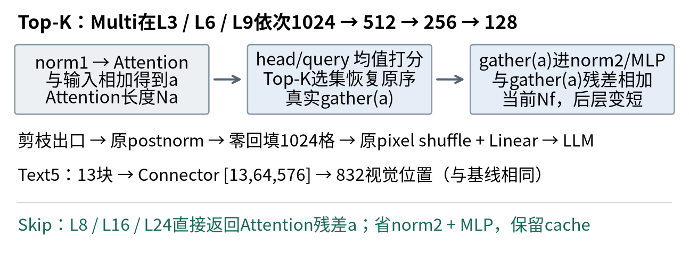

# SmolVLM无需训练压缩实验报告

Sean-xzx · 2026年11月1日 · professor-report-v3

## 0 主要结果

比较视觉Encoder Top-K与LLM FFN Skip，无训练。SmolVLM-256M-Instruct在TextVQA、ScienceQA-IMG各固定256题上评估六配置，共12组3072条预测。两方法分别运行，不叠加。

|配置|TextVQA软分 %|Δ pp|ScienceQA准确率 %|Δ pp|
|---|---|---|---|---|
|baseline|54.4922|+0.0000|64.0625|+0.0000|
|early|43.5547|-10.9375|55.0781|-8.9844|
|middle|42.1484|-12.3438|58.2031|-5.8594|
|late|47.9688|-6.5234|60.5469|-3.5156|
|multi|13.6328|-40.8594|32.8125|-31.2500|
|skip|32.9688|-21.5234|32.4219|-31.6406|

所有变体质量下降。Late在四种Top-K中损失最小；Multi虽减少59.588%的Encoder主要FLOPs，质量损失最大。Skip固定16输出token的速度比为0.993×/1.002×，同长度收益不明确。

压缩收益限于部分计算路径：Top-K缩短Encoder内部序列，零回填后LLM视觉位置保持；六配置权重存储相同，allocated峰值也未明显下降。完整成本与延迟见§2.3、§5。

[任务A四问](#2-任务a-encoder-top-k) · [任务B](#3-任务b-projector) · [任务C三问](#4-任务c-ffn-skip) · [验证](#6-正确性与执行证据) · [明细附录](#附录a-完整逐层token)

## 1 实验协议

### 1.1 输入与生成

两集均用validation，分别从5000/2097题以Random(20261029)无放回抽256并升序，保存ID、图像SHA和meta。所有配置同图片、prompt、input IDs及生成设置。模型/数据revision、软件与硬件明细在附录D1。

原生Idefics3Processor处理RGB图像，最长边2048、图块512，每块1024位置，无额外CLS。Text输入图片/问题/短答案指令，不加OCR字段；Science另含原始非空hint和原序选项，不输入answer、lecture或solution。

统一RTX5090 Laptop、BF16、batch1、eager、eval/inference_mode、seed0、确定性、TF32关闭；greedy、beam1、max_new_tokens64及EOS/cache固定。eager显式返回Attention权重，基线也用eager，Flash/SDPA未测。

### 1.2 评分

Text原样复用MMF的EvalAIAnswerProcessor与TextVQAAccuracyEvaluator：十参考逐一留出，以另九条匹配数m计算min(m/3,1)，对十次留一及256题分别平均。因此是软分。Science采用官方选项索引准确率定义，生成文本由本地label-blind extract_choice v2保守解析；未运行完整官方管线。

解析失败/空输出记0并保留256分母；执行异常标未完成，正式3072条无执行异常。Text闭式复核与normalizer同源边界、Science解析失败及实际G见附录D。当前Science64.0625%不代表复现官方73.6% recipe。

## 2 任务A Encoder Top K

### 2.1 方法与配置

令a=x+Attention(norm1(x))。在Attention残差后、当前FFN前，对[块,head,query,key]权重以FP32平均head及有效query，为各key打分。每块取K=max(1,ceil(rate×当前有效数))个最高分，平分按原位置，选集恢复原序；gather(a)进入当前norm2/MLP及其残差，后层继续短序列。支持1起层列表和逐阶段比例。

|配置|Encoder层与阶段保留率|每块实际K及最终率|Skip层|
|---|---|---|---|
|baseline|无|1024；100%|无|
|early|3；50%|512；50%|无|
|middle|6；50%|512；50%|无|
|late|9；50%|512；50%|无|
|multi|3→6→9；各50%|512→256→128；12.5%|无|
|skip|无|1024；100%|8/16/24|

12层Encoder的L/4、L/2、3L/4恰为3/6/9。单点分别独立；Multi在同次前向的当前序列重新打分。各图块独立，padding不参与评分/回填，边界处理见附录A。



图1 Top-K缩短当前FFN及后层Encoder，Skip省独立FFN分支。来源：冻结代码与context-v2 B4 Text row5，n=1代表题；单位为token/块和张量shape，示意不作Attention归因。

### 2.2 必答A1 参数与Token

六配置sum(p.numel())均为256,484,928，原权重文件均513,028,808 bytes；没有删权重或导出更小checkpoint。Top-K改变激活长度：单点出口512、Multi128。剪枝当层Attention长度Na仍为旧值，FFN长度Nf已缩短；后层Attention才变短。完整12层Na/Nf在附录A。

### 2.3 必答A2 Encoder与全模型FLOPs

乘加计2。每视觉层主要FLOPs为：

```text
8BNa dv² + 4BNa²dv + 4BNf dv mv
```

三项依次为QKV/O、QK/AV、fc1/fc2；B为图块数，dv=768、mv=3072。按实际Na/Nf逐层求和，Early/Middle/Late/Multi的Encoder本体分别减少43.182%/29.545%/15.909%/59.588%。全模型还含patch、Connector、LLM prefill/decode及输出头，不能直接乘最终保留率。

附录B给六配置的Encoder/全模型绝对成本、相对比例及完整公式，统一离线G*=16、每集256题。该估算不是512题额外fixed16实测。打分、转换、排序与移动开销的计数/排除范围也在附录B。

### 2.4 必答A3 真实少算的证明

固定Text row5，B=13、T=889。单点剪枝当层及下一层fc1 pre-hook均为[13,512,768]；原addmm的[13312,768]×[768,3072]变为[6656,768]×[768,3072]。Multi三阶段如下，下一层继续相同短长度。

|剪枝层→后层|两层fc1 pre-hook|addmm矩阵A × B|CUDA μs 当前/后层|
|---|---|---|---|
|3→4|[13,512,768]|[6656,768] × [768,3072]|458.17 / 455.80|
|6→7|[13,256,768]|[3328,768] × [768,3072]|209.70 / 205.31|
|9→10|[13,128,768]|[1664,768] × [768,3072]|109.57 / 106.62|

这是单次诊断profiler，不能当稳定速度基准。附录C给五配置的fc1/fc2 pre-hook、CPU/CUDA时间及Multi后层q_proj/QK/AV矩阵，覆盖每次剪枝；完整trace由[E3](../docs/EVIDENCE_INDEX.zh.md#e3)定位。

### 2.5 必答A4 从视觉到LLM

Text row5输入[13,1024,768]，Encoder出口为基线[13,1024,768]、单点[13,512,768]、Multi[13,128,768]。仅剪枝路径在原postnorm之后按原位置零回填，随后三者均走：

```text
Connector入口 [13,1024,768] → pixel shuffle [13,64,12288]
→ Linear输出 [13,64,576] → LLM视觉位置832，总输入T=889
```

postnorm后回填使丢弃位置保持精确0，原Connector/LLM位置契约不变。因此只减少Encoder内部计算，同G下Connector与LLM序列未缩短。832是代表题数值，各题块数范围见附录D。

## 3 任务B Projector

|方法|特征映射|Token数量|
|---|---|---|
|Linear|逐位置线性投影|通常保持N|
|MLP|逐位置多层Linear与非线性|通常保持N|
|Q-Former|学习query跨注意力读取视觉特征|由query数决定|
|Perceiver Resampler|固定学习latent重采样视觉特征|由latent数决定；Flamingo典型64|

本模型原Connector先4×4 pixel shuffle将1024位置合并为64、通道768变12288，再以单个无bias Linear投影至576。SimpleMLP类实际只有一个Linear，数量变化来自pixel shuffle。剪枝适配见§2.5；这里仅作方法说明，未新增四组实验。[BLIP-2](https://arxiv.org/abs/2301.12597v3)、[Flamingo §2.1/A.1.1](https://arxiv.org/abs/2204.14198v2)和[实际连接代码](../scripts/encoder_topk.py#L180)供核查。

## 4 任务C FFN Skip

### 4.1 层选择与残差

30层LLM预先分散选8/16/24层同时Skip，层列表可配置，未搜索最优层。目标层返回a=x+Attention(inputnorm(x))，省整个post_attention_layernorm与MLP；Attention、inputnorm、KV cache及最终norm保留。实现见[skip_forward](../scripts/ffn_skip.py#L16)。

### 4.2 必答C1 参数

实际总参数/权重文件与§2.2相同，仍注册在state_dict。每个gated FFN含3×576×1536=2,654,208参数，三层停用7,962,624；norm2另1,728。统计是停用计算的权重数，实际存储未减少。

### 4.3 必答C2 FLOPs

T含视觉与文本，G为新生成token数。prefill产生首token，其后G−1次cached decode；三层FFN主要矩阵节省为：

```text
ΔFprefill = 15,925,248 T
ΔFdecode = 15,925,248 (G−1)
ΔFtotal = 15,925,248 (T+G−1)
```

系数为3层×6×576×1536。G=1时decode为0；Attention仍30层、FFN27层，norm2不含于主要矩阵式。G*=16时全模型仅省约0.47%/0.49%（Text/Science）；完整分项见附录B。

### 4.4 必答C3 未执行的证明

旧cost-perf-v1 Text row1848，B=13、T=888，记录prefill和一步独立cache decode。每个目标层L8/16/24的计数如下。

|配置|每阶段inputnorm / Attention|每阶段norm2 / MLP|两阶段各投影marker合计|
|---|---|---|---|
|baseline|1 / 1|1 / 1|gate/up/down各2次|
|skip|1 / 1|0 / 0|全部缺席|

非目标层正常。零调用结合投影区间缺席，证明未先算再丢弃。v3独立Text5短trace另见MLP矩阵180→162，减少3层×3投影×2阶段=18；不与主性能拼接毫秒。[E4原件](../docs/EVIDENCE_INDEX.zh.md#e4)注明样本/模块及范围。

## 5 实测效率与取舍

只用旧cost-perf-v1主基准：natural/first每集4题，fixed16/stages每集1题，各2预热5正式重复；总780正式/312预热，锚点另计。同步计时从GPU已有输入至native generate返回，保留生产选择/回填/同步，不含加载、Processor、H2D、评分/I/O。

下表fixed16为同G=16的五次median；速度比为同集基线wall/变体wall。自然G为另4题的均值，不能当fixed16的输出长度。逐题Q1/Q3、自然/首token延迟及版本范围见附录D和[原图源](../figures/performance_samples.csv)。

|配置|Text fixed16 ms / 速度比|Science fixed16 ms / 速度比|自然G均值 T/S|
|---|---|---|---|
|baseline|414.22 / 1.000×|417.66 / 1.000×|6.5 / 3.5|
|early|338.77 / 1.223×|364.02 / 1.147×|6 / 4|
|middle|391.04 / 1.059×|374.21 / 1.116×|5.5 / 4|
|late|401.35 / 1.032×|412.21 / 1.013×|5.25 / 4|
|multi|323.14 / 1.282×|325.15 / 1.285×|5 / 3.5|
|skip|417.23 / 0.993×|416.89 / 1.002×|3.5 / 3|

矩阵FLOPs减少不保证同比wall收益：排序、gather/零回填、CPU同步与调度未全部计入主要FLOPs。旧独立Connector回放剪枝约4–5 ms、基线约0.3–0.5 ms，但独立模块median不能相加减作端到端归因。Text Skip自然G从6.5降到3.5，少输出参与自然提速；fixed16则未见明确收益。

allocated峰值约2902 MiB，剪枝略增、Skip几乎相同；reserved不能替代活跃显存。未锁频，旧锚点变化−2.46%/+3.83%；小样本/五次重复不构成总体置信区间。

## 6 正确性与执行证据

|检查|比较对象|保存结果|
|---|---|---|
|单点100% / Multi全100%，关闭额外路径|Text5/Science2×四模式：Encoder/postnorm/Connector/prefill logits及完整生成IDs|32张量最大误差0，atol=rtol=0；IDs相等，score/scatter调用0|
|空Skip|两输入prefill及独立cache一步decode最后位置logits、完整IDs|最大误差0，atol=rtol=0；IDs相等|

100%原生bypass不验证真实50%选集/gather，后者由受控数值、pre-hook与矩阵支撑（§2.4、附录C）。Encoder未单独比较decode logits；非空Skip执行另见§4.4。正常/受控异常清理通过，任意OOM/kill未验证。精选[E2](../docs/EVIDENCE_INDEX.zh.md#e2)的B2索引是导航摘录，完整proof/trace在科学附件。

## 7 限制来源与复现

### 7.1 结论边界

结果支持固定两子集、单GPU/BF16/batch1/eager下的路径与取舍，未证明最优层或损失因果。所有负结果保留：Multi/Skip质量损失大，权重存储未降，峰值未明显改善。Science Skip41条解析失败全救回也仅48.4375%，低于基线64.0625%；不能用格式失败解释全部损失。

冷安装、跨机/其他GPU、Flash/SDPA、新入口完整256、v3 first/stages及任意OOM/kill未验证。3072质量、780主性能、v3迁移和新增24条不混用（附录D3）。

### 7.2 来源与贡献

复用Transformers4.57.6的Idefics3/Llama、Processor/generate及MMF评分；Top-K/Skip为必要实例级适配，Science文本解析为本地实现。[来源及改动](../docs/SOURCES_AND_CHANGES.zh.md)、[许可](../NOTICE.md)逐项保留。

AI主要完成代码适配、实验编排、统计/自动核验及报告写作制图；Sean-xzx提供任务与范围决策。核验包括原子结果重聚合、源SHA、形状/调用记录和同源渲染。未声称Sean-xzx亲写、已审阅或独立掌握；教授指定现场环节须本人独立完成、不调用AI/Agent。

### 7.3 复现入口

[仓库](https://github.com/Sean-xzx/Smolvlm-Compression-Study)提供代码/六配置/依赖锁、清单与精选证据；推理须另取完整科学包及固定模型缓存。按[复现说明](../docs/REPRODUCTION.zh.md)下载校SHA、解包、准备数据，再运行evaluate_release（新预测）、release_checks（正确性/性能/profiler）或analyze_costs（只读CPU成本）；输出均为包外新目录。只读结构检查：`python3 -B scripts/check_repository.py`。原文覆盖见附录E。

## 附录A 完整逐层Token

context-v2 Text row5，13独立图块；每格Na/Nf，单位token/块。baseline与Skip视觉路径相同。

|层|baseline及skip|early|middle|late|multi|
|---|---|---|---|---|---|
|1|1024/1024|1024/1024|1024/1024|1024/1024|1024/1024|
|2|1024/1024|1024/1024|1024/1024|1024/1024|1024/1024|
|3|1024/1024|1024/512|1024/1024|1024/1024|1024/512|
|4|1024/1024|512/512|1024/1024|1024/1024|512/512|
|5|1024/1024|512/512|1024/1024|1024/1024|512/512|
|6|1024/1024|512/512|1024/512|1024/1024|512/256|
|7|1024/1024|512/512|512/512|1024/1024|256/256|
|8|1024/1024|512/512|512/512|1024/1024|256/256|
|9|1024/1024|512/512|512/512|1024/512|256/128|
|10|1024/1024|512/512|512/512|512/512|128/128|
|11|1024/1024|512/512|512/512|512/512|128/128|
|12|1024/1024|512/512|512/512|512/512|128/128|

正式24576层记录padding均0；受控有效数[16,5]按ceil得[8,3]→[4,2]→[2,1]。不同K用Kmax物理占位，padding不参与key/query评分及原位置回填。Multi复合原位置。受控记录中禁用key权重109584项最大0、扰动padding不改有效输出；回填保留相等、丢弃精确0。它们是有限样本/fixture证明，不是任意输入保证。

## 附录B FLOPs公式与结果

### B1 公式与计数范围

B为图块数，N0=1024；视觉dv=768、mv=3072、H=12。LLM d=576、m=1536、30层、9Q/3KV、head64、d_kv=192、V=49280。FMA计2；Encoder本体按§2.3逐层Na/Nf，其他项如下。

|部分|主要FLOPs|
|---|---|
|patch卷积|2BN0(3×16²)dv|
|原Connector|2B×64×12288×576|
|LLM每层GQA投影|4qd(d+d_kv)|
|LLM每层QK/AV|4qsd|
|LLM每层gated FFN|6qdm；基线30层、Skip27层|
|输出头每次|2×1×d×V，仅最后位置|
|全模型|patch + ΣEncoder + Connector + LLM prefill + Σdecode + G个头|

prefill令q=s=T；decode第j步（j=1…G−1）令q=1、s=T+j。n=G−1，则Σs=nT+n(n+1)/2；视觉/Connector仅prefill一次。每题先按真实B/T/G计算再汇总，不能将平均T代入T²。Skip三层节省见§4.3。

FP32 score按BN²(H+2)基本算术、Attention cast按每元素BF16读2+FP32写4 bytes单列，每阶段每块3次stable argsort。bias、norm、激活、softmax/rope、比较排序、gather/scatter、CPU循环/同步、KV移动、查表及预处理/H2D/I/O不并入主要矩阵总数；辅助字段在[成本CSV与components](../scripts/analyze_costs.py#L24)保留。估算不是硬件指令实测。

### B2 六配置绝对成本与相对变化

统一离线G*=16，每集n=256，逐题GFLOPs算术均值；T/S为Text/Science。Encoder列不含patch，全模型含上述主要项。实际G分项及min/max另在[costs.csv](../figures/costs.csv)、[ranges.csv](../figures/ranges.csv)，不与fixed16延迟混称。

|配置|Encoder GF T/S|Encoder比|全模型 GF T/S|全模型比 T/S|
|---|---|---|---|---|
|baseline|2903.33 / 2986.38|1.0000|3195.75 / 3309.64|1.0000 / 1.0000|
|early|1649.62 / 1696.81|0.5682|1942.04 / 2020.07|0.6077 / 0.6104|
|middle|2045.53 / 2104.04|0.7045|2337.95 / 2427.30|0.7316 / 0.7334|
|late|2441.44 / 2511.27|0.8409|2733.86 / 2834.53|0.8555 / 0.8564|
|multi|1173.29 / 1206.85|0.4041|1465.71 / 1530.11|0.4586 / 0.4623|
|skip|2903.33 / 2986.38|1.0000|3180.68 / 3293.32|0.9953 / 0.9951|

## 附录C 矩阵与pre-hook明细

### C1 当前与后层FFN

context-v2 B4 Text5，B=13、T=889、单次prefill。fc1/fc2实际pre-hook、addmm矩阵输入及同条operator的CPU/CUDA μs如下；诊断时间不相加、不作规范速度比。所有单点剪枝当层/后层和Multi三阶段均覆盖。

|配置/层/模块|pre-hook|矩阵A × B|CPU μs|CUDA μs|
|---|---|---|---|---|
|baseline L3 fc1|[13,1024,768]|[[13312,768],[768,3072]]|31.26|986.68|
|baseline L3 fc2|[13,1024,3072]|[[13312,3072],[3072,768]]|29.71|926.78|
|baseline L6 fc1|[13,1024,768]|[[13312,768],[768,3072]]|31.52|1047.13|
|baseline L6 fc2|[13,1024,3072]|[[13312,3072],[3072,768]]|29.94|982.17|
|baseline L9 fc1|[13,1024,768]|[[13312,768],[768,3072]]|30.63|1051.00|
|baseline L9 fc2|[13,1024,3072]|[[13312,3072],[3072,768]]|29.27|985.85|
|early L3 fc1|[13,512,768]|[[6656,768],[768,3072]]|49.42|450.59|
|early L3 fc2|[13,512,3072]|[[6656,3072],[3072,768]]|33.90|414.59|
|early L4 fc1|[13,512,768]|[[6656,768],[768,3072]]|31.16|449.24|
|early L4 fc2|[13,512,3072]|[[6656,3072],[3072,768]]|30.13|414.53|
|middle L6 fc1|[13,512,768]|[[6656,768],[768,3072]]|68.00|527.58|
|middle L6 fc2|[13,512,3072]|[[6656,3072],[3072,768]]|36.73|494.30|
|middle L7 fc1|[13,512,768]|[[6656,768],[768,3072]]|32.56|526.72|
|middle L7 fc2|[13,512,3072]|[[6656,3072],[3072,768]]|30.88|493.60|
|late L9 fc1|[13,512,768]|[[6656,768],[768,3072]]|105.30|446.30|
|late L9 fc2|[13,512,3072]|[[6656,3072],[3072,768]]|45.39|407.96|
|late L10 fc1|[13,512,768]|[[6656,768],[768,3072]]|48.64|443.07|
|late L10 fc2|[13,512,3072]|[[6656,3072],[3072,768]]|34.20|409.31|
|multi L3 fc1|[13,512,768]|[[6656,768],[768,3072]]|110.10|458.17|
|multi L3 fc2|[13,512,3072]|[[6656,3072],[3072,768]]|54.32|421.50|
|multi L4 fc1|[13,512,768]|[[6656,768],[768,3072]]|50.16|455.80|
|multi L4 fc2|[13,512,3072]|[[6656,3072],[3072,768]]|36.48|422.24|
|multi L6 fc1|[13,256,768]|[[3328,768],[768,3072]]|46.99|209.70|
|multi L6 fc2|[13,256,3072]|[[3328,3072],[3072,768]]|35.62|188.99|
|multi L7 fc1|[13,256,768]|[[3328,768],[768,3072]]|32.46|205.31|
|multi L7 fc2|[13,256,3072]|[[3328,3072],[3072,768]]|55.58|189.41|
|multi L9 fc1|[13,128,768]|[[1664,768],[768,3072]]|46.56|109.57|
|multi L9 fc2|[13,128,3072]|[[1664,3072],[3072,768]]|35.34|98.24|
|multi L10 fc1|[13,128,768]|[[1664,768],[768,3072]]|43.11|106.62|
|multi L10 fc2|[13,128,3072]|[[1664,3072],[3072,768]]|33.25|96.51|

### C2 Multi后层Attention

L4/L7/L10承接三次剪枝，q_proj pre-hook分别[13,512/256/128,768]，B×H=156；下面为实际q_proj/QK/AV输入和CPU/CUDA μs。完整12层矩阵与具名score/select/scatter trace见[E3](../docs/EVIDENCE_INDEX.zh.md#e3)。

|层与算子|矩阵输入A / B|CPU μs|CUDA μs|
|---|---|---|---|
|L4 q_proj|[[6656,768],[768,768]]|39.47|116.93|
|L4 QK|[[156,512,64],[156,64,512]]|27.13|246.43|
|L4 AV|[[156,512,512],[156,512,64]]|27.25|215.55|
|L7 q_proj|[[3328,768],[768,768]]|53.44|59.14|
|L7 QK|[[156,256,64],[156,64,256]]|27.11|50.62|
|L7 AV|[[156,256,256],[156,256,64]]|24.58|42.85|
|L10 q_proj|[[1664,768],[768,768]]|42.19|34.27|
|L10 QK|[[156,128,64],[156,64,128]]|28.32|14.14|
|L10 AV|[[156,128,128],[156,128,64]]|24.86|12.70|

## 附录D 协议与统计明细

### D1 固定版本与评分补充

|对象|固定revision|
|---|---|
|模型|7e3e67edbbed1bf9888184d9df282b700a323964|
|lmms-lab-encoder/textvqa|9c0699cd19768ac5ab97568f6b3cbac4c0062884|
|lmms-lab/ScienceQA-IMG|b9984af01798586705cee1fbdfa80a6dcbef04f1|

两数据集均default/validation。图片、抽样ID/SHA与meta见[清单](../data/manifests)，协议见[eval_protocol_context_v2](../configs/eval_protocol_context_v2.json)。Python3.10.12、torch2.7.1+cu128、Transformers4.57.6、RTX5090 Laptop24463 MiB、driver580.178.04；pixel_values输入FP32，原生模型按需转dtype。

Text十参考中标准化后有c次匹配时，闭式如下；1536历史输出独立重聚合差异0，但normalizer与MMF/Pythia同源。

```text
s(c) = [(10−c) min(c/3,1) + c min(max(c−1,0)/3,1)] / 10
c=0,1,2,3,4,10 → s=0,0.3,0.6,0.9,1,1
```

[MMF固定源码](https://github.com/facebookresearch/mmf/blob/72f898ec35af86567423c7a019dd1dc5175d1a5a/mmf/utils/m4c_evaluators.py)、[ScienceQA准确率定义](https://github.com/lupantech/ScienceQA/blob/2cbf8318e07b9ece895bb2ae605e71e38d623264/tools/evaluate_acc.py)。Science hint协议在控制诊断前冻结，旧无hint58.984375%不进入分差，官方73.6%完整recipe未复现。

### D2 长度与延迟统计

质量每组n=256。G为记录的新token数；下表为均值[min,max]，截断/解析失败均保留分母。截断列T/S分别为Text/Science。

|配置|Text G均值与范围|Science G均值与范围|截断 T/S|Sci解析失败|
|---|---|---|---|---|
|baseline|5.273 [3,16]|4.500 [2,64]|0/1|1|
|early|5.309 [3,15]|3.914 [2,12]|0/0|1|
|middle|5.133 [2,18]|3.938 [2,26]|0/0|1|
|late|5.754 [2,64]|4.250 [2,33]|2/0|1|
|multi|6.316 [2,64]|4.082 [2,64]|5/2|28|
|skip|5.906 [3,64]|4.688 [2,64]|2/2|41|

基线256题范围：Text B=9–17、T=622–1163、实际G=3–16、总成本2092.5–3991.7 GF；Science B=5–17、T=379–1394、G=2–64、1164.3–4081.6 GF。代表题832位置不代表所有图片。

下表为cost-perf-v1：natural/first取每集4题各5重复median的均值，fixed16取每集1题5重复median，单位ms；每题另2预热。逐题Q1/Q3由5次实测排序的线性分位数得到，区间通常非对称，不是总体置信区间。数值/图源见[performance_samples.csv](../figures/performance_samples.csv)及[fixed16图](../figures/05_fixed16.png)/[自然生成图](../figures/06_natural.png)。

|数据/配置|natural ms|自然速度比|实际G均值|first ms|fixed16 ms / 速度比|
|---|---|---|---|---|---|
|T / baseline|297.235|1.000×|6.5|219.35|414.22 / 1.000×|
|T / early|193.208|1.538×|6|118.47|338.77 / 1.223×|
|T / middle|221.912|1.339×|5.5|156.62|391.04 / 1.059×|
|T / late|248.093|1.198×|5.25|182.99|401.35 / 1.032×|
|T / multi|167.404|1.776×|5|104.65|323.14 / 1.282×|
|T / skip|257.427|1.155×|3.5|221.71|417.23 / 0.993×|
|S / baseline|271.576|1.000×|3.5|236.52|417.66 / 1.000×|
|S / early|169.816|1.599×|4|129.78|364.02 / 1.147×|
|S / middle|213.897|1.270×|4|169.30|374.21 / 1.116×|
|S / late|249.613|1.088×|4|193.59|412.21 / 1.013×|
|S / multi|146.713|1.851×|3.5|110.84|325.15 / 1.285×|
|S / skip|253.235|1.072×|3|235.76|416.89 / 1.002×|

780正式/312预热由natural240、first240、fixed16 60、stages/decode240组成；锚点另20正式。first的G=1，fixed16通过min=max_new_tokens16控制，文本不进质量表。CUDA Event为辅助stream elapsed；单步decode用fresh prefill cache和固定基线首token，wrapper含位置/cache构造。独立阶段median不相加减推因果。

### D3 版本隔离与未验证范围

|版本|用途与已验证范围|
|---|---|
|context-v2|原3072正式质量；本报告全部质量/pp来源|
|cost-perf-v1|旧780正式/312预热主性能；全部主毫秒与速度比来源|
|postday3-v3|同机热缓存迁移验证：120正式/48预热，锚点20/8；不混入主性能；first/stages未跑|
|20261031薄入口|六配置×两集前2题共24条，新raw/IDs/score等与历史诊断相等；partial单列，完整256未跑|

同机共享解释器/HF热缓存不能证明冷安装或跨机。完整科学包提供512PNG、原子结果及trace，轻量Git仅精选；来源/下载及SHA在[发布说明](../docs/PUBLICATION.zh.md)。本报告只改呈现，不新增实验。旧Release报告及历史回执保留，不用于验证新版报告字节。

## 附录E 原文检查定位

|教授要求|本报告位置|
|---|---|
|模型/数据/评分/公平环境|§1；D1/D2|
|A1 参数/权重/逐层Token|§2.2；附录A|
|A2 Encoder/全模型FLOPs与额外开销|§2.3；B1/B2|
|A3 pre-hook/矩阵shape/time与Multi各阶段|§2.4；C1/C2|
|A4 Projector入出/LLM视觉位置|§2.5；图1|
|B 四类方法及指定模型连接器|§3|
|C1 参数；C2 prefill/decode成本；C3执行证明|§4.2；§4.3/B1；§4.4|
|六配置12组、正确性、延迟/G/样本量|§0/§2.1；§6；§5/D2/D3|
|代码/复现/来源/AI/限制|§7；仓库67项映射|

[教授原文](../docs/ASSIGNMENT.zh.md) · [67项代码与证据映射](../docs/REQUIREMENTS_MAPPING.zh.md) · [E1–E8证据索引](../docs/EVIDENCE_INDEX.zh.md) · [数据/评估/检查/性能运行命令](../docs/REPRODUCTION.zh.md)
